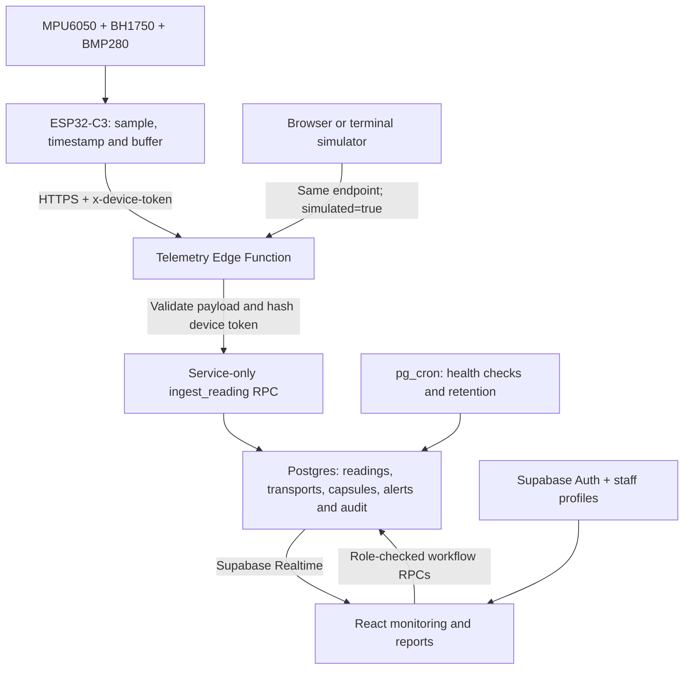

# ASQAC · Capsule Care Connect — Implementation and Verification Report

**Report date:** 2 November 2026, India Standard Time (IST)  
**Project:** Adaptive Specimen Quality Assurance Capsule (ASQAC)  
**Workspace:** `D:\college\ASQAC`  
**Supabase project:** `chhpbpqoaikbcicxdnzj`

**3 November 2026 firmware addendum:** root `code.txt` and its identical `firmware/asqac-esp32/asqac-esp32.ino` copy contain the final self-contained circuit firmware. It preserves the classic ESP32 pin pairs, raw-register sensor reads and gyro calibration, and adds authenticated telemetry, correct units, impact/light peaks and offline queuing. HTML, the local server and custom header dependencies are removed. Wi-Fi, the actual endpoint, registered demo device token and trusted TLS root are included directly as requested. See [the circuit guide](../firmware/asqac-esp32/README.md), [logic checks](circuit-firmware-verification.json) and [latest full board build](circuit-firmware-build.json). No physical-board test or change to the previously verified cloud database snapshot is claimed.

**Final latency/backend addendum:** the physical Serial logs exposed about 32 seconds of FIFO backlog and a 429 generated by ASQAC's legacy limiter. Migration `202611030006_batch_ingestion.sql` and the updated Edge Function are now deployed and tracked. The final sketch captures every 500 ms, timestamps in milliseconds and sends up to 16 queued readings per request at approximately one request/second. Batch rate limiting is anchored to accepted batch starts (750 ms minimum), fixing the mismatch after a slow request. History, threshold evaluation and duplicate-safe replay are retained. The orientation filter and 3D model handle angle wrap and smooth measured transitions. Thirty local tests pass; native firmware tests and a complete ESP32 Dev Module build pass. An isolated simulated cloud test drained 13 rows in one request, accepted following batches and observed 15 unique Realtime deliveries. See [hosted batch results](batch-cloud-verification.json) and [latency analysis](LATENCY_FIX.md). This changes the current migration total to six and supersedes the older sampling/body-limit details below: the batch endpoint accepts up to 16 readings within 16 KiB. The original 2 November lifecycle/browser evidence remains historical; no new browser verification was performed for this update. Updated firmware must still be flashed to the physical board.

**Barometry addendum — 3 November 2026:** migration `202611030007_barometric_height.sql` and the updated telemetry Edge Function are deployed, with all seven migrations tracked remotely. BMP280 pressure now produces estimated altitude and relative height change in live detail, overview readings, trends and printable reports. The single-file firmware establishes a stable startup pressure baseline and transmits its pressure/time provenance. Database-generated estimates and retained transport summaries preserve the values, while legacy readings retain an unknown height change. Height trends break across reference resets. Thirty-four local tests, native firmware checks, strict frontend/Edge TypeScript and the full ESP32 Dev Module build pass. The isolated hosted test verified 15 unique rows/events, zero/rise/fall calculations, staff RLS access and Realtime reference metadata. No browser check or physical altitude calibration was performed. The frontend production build is updated locally; the backend deployment is live. See [barometric implementation notes](BAROMETRIC_METRICS.md) and [hosted evidence](barometry-cloud-verification.json).

**Offline display correction — 3 November 2026:** live scalar readings now expire after 15 seconds without fresh observation and receipt timestamps. A shared freshness gate covers capsule detail, overview and fleet temperatures; altitude, height, motion and RSSI clear to “—”, and the 3D model is replaced with an offline placeholder. A 500 ms UI clock detects expiry without further packets or a refresh. Fresh packets restore readings automatically; polling cached rows or ingesting buffered history cannot revive stale measurements. Historical charts, packet-age diagnostics and reports remain available. Both new expiry/recovery tests pass with the existing suite (36 tests total). This is a frontend change; no firmware flash or backend migration is required for the offline display fix. No browser checks were performed.

**Rendering and update consistency addendum — 3 November 2026:** delayed refresh snapshots now merge with newer Realtime readings instead of replacing them. A bounded single-sort merge replaces the previous repeated full-fleet scans, and memoized histories let charts and the orientation view skip clock-only redraws. Live trend animations no longer restart on incoming samples. The model initializes at the actual first pose, then uses the existing shortest-angle damping; numerical tickers reset correctly after offline gaps. Raw gyro X/Y/Z is shown in °/s, unprofiled meters say “Measured,” and the unprofiled temperature gauge spans −10 to 50 °C. The final suite has 38 passing tests, including snapshot/replay and independent per-capsule history bounds. A nondeterministic closed-transport test timestamp was also corrected: it now selects an unused microsecond observation rather than accidentally exercising duplicate replay. No application authorization or ingestion policy changed. Firmware contract checks pass; physical post-flash latency and visual browser behaviour remain unverified in this pass.

**GitHub/Vercel deployment addendum — 3 November 2026:** the complete source is published to `aequitas-n/asqac`, and Vercel project `aequitas01/asqac-capsule-care-connect` automatically deploys `main`. The Git-triggered build for the first commit reached Ready. Production uses Node 24, `npm ci`, `npm run build` and `dist`; all four browser-safe Vite variables are configured for production and preview. The production domain is https://asqac-capsule-care-connect.vercel.app. Public routes/assets, both staff sign-ins, staff RLS reads and telemetry CORS passed HTTP verification without a browser or telemetry writes. Supabase Auth URLs and the allowed telemetry origin are configured for this domain. Local environment files, administrative keys, tool caches and generated builds are excluded from Git. The intentionally documented demo device token remains in the single-file firmware as requested. Supabase URL and the physical device endpoint are unchanged. See [deployment metadata](frontend-deployment.json) and [production checks](production-deployment-verification.json).

## 1. Result and delivery status

The ASQAC web application has been implemented, redesigned to match the requested visual direction, connected to the supplied Supabase project, and verified through both backend integration checks and an actual browser workflow.

The working software covers specimen registration, capsule assignment, transport preparation and start, live telemetry, handling excursions, acknowledgement, receiving-doctor review, final verdicts, custody history and reporting. Browser and terminal simulators send explicitly simulated measurements to the same deployed ingestion endpoint intended for the ESP32.

The Supabase backend and Vercel frontend are deployed. GitHub `main` triggers production builds, and HTTP/Auth integration checks pass on the public domain. The adapted ESP32 Dev Module firmware has a verified board build; the original C3 variant remains uncompiled in this session. Neither variant has been flashed or physically tested here. All sensor measurements used in the cloud verification were simulated.

| Deliverable                                     | Status                                                            | Evidence or location                                         |
| ----------------------------------------------- | ----------------------------------------------------------------- | ------------------------------------------------------------ |
| React frontend and application pages            | Implemented; build verified                                       | `src/`, `package.json`                                       |
| Requested visual redesign                       | Implemented                                                       | `src/styles.css`, `src/components/layout/`, live screenshots |
| Supabase client and environment configuration   | Connected to the supplied project                                 | `src/lib/supabase.ts`, ignored `.env`                        |
| Schema, constraints, indexes and RLS            | Installed in Supabase                                             | Five files in `supabase/migrations/`                         |
| Auth accounts and staff roles                   | Provisioned; both logins verified                                 | Backend and browser verification records                     |
| Telemetry Edge Function                         | Deployed; normal and stress ingestion verified                    | `supabase/functions/telemetry/`                              |
| Realtime updates                                | Hosted delivery and browser updates verified                      | Six published application tables                             |
| Scheduled health and retention jobs             | Installed and active                                              | `supabase/optional/cron.sql`                                 |
| Handling profiles, capsules and historical data | Seeded                                                            | Seven profiles, four capsules, nine historical transports    |
| Browser and terminal simulators                 | Implemented and verified against the hosted endpoint              | `src/components/Simulator.tsx`, `scripts/simulator.mjs`      |
| ESP32 firmware                                  | Written and locally configured; physical verification outstanding | `firmware/asqac/`                                            |
| Combined SQL Editor installation                | Generated, executed and repeat-install tested                     | `supabase/ASQAC_SETUP.sql`                                   |
| Setup and operating documentation               | Written                                                           | `README.md`                                                  |
| Public frontend hosting                         | Ready for deployment; not performed                               | `vercel.json`, `public/_redirects`, `dist/`                  |
| Tube rotation and MR damper                     | Informational hardware/roadmap sections                           | `src/pages/Hardware.tsx`                                     |

## 2. Product scope and architecture

The application addresses the pre-analytical transport stage: conditions observed while a specimen moves from an origin ward to a receiving laboratory. It records handling conditions and supports the receiving clinician's decision. It does not independently establish specimen suitability or diagnose a patient.



No separate application server is required. Static frontend hosting can serve the built Vite application, while Supabase supplies authentication, database storage, Realtime and Edge execution.

### Technology used

| Area                | Implementation                                                            |
| ------------------- | ------------------------------------------------------------------------- |
| Application         | React 18, Vite 6 and strict TypeScript                                    |
| Styles              | Tailwind CSS, CSS variables and custom component styling                  |
| Charts and movement | Recharts and Framer Motion                                                |
| 3D orientation      | Three.js, React Three Fiber and Drei; loaded separately                   |
| Routing             | React Router                                                              |
| Form handling       | React Hook Form with Zod validation                                       |
| QR functionality    | `html5-qrcode` scanning and `qrcode.react` labels                         |
| Icons and feedback  | Lucide icons, Sonner notifications and date-fns                           |
| Backend             | Supabase Auth, Postgres, RLS, Realtime and Deno/TypeScript Edge Functions |
| Automated checks    | Node test runner, PGlite/PostgreSQL and Playwright                        |
| Firmware            | Arduino C++ for ESP32-C3                                                  |

The existing repository uses Vite, so the Supabase browser configuration uses `VITE_` environment variables and plain `supabase-js`, rather than Next.js configuration or `@supabase/ssr`.

## 3. Frontend pages and user experience

### Visual redesign

The interface was changed to follow `uialone-prompt.txt` and `reference.webp`. The final design uses a light neutral frame, opaque white panels, solid medical teal, restrained borders, rounded controls and clear typography. Violet blends, blue gradients, glass effects, backdrop blur and decorative glows were removed.

Locally bundled Plus Jakarta Sans, Inter and JetBrains Mono support the distinction between headings, explanatory text and measured values/identifiers. The application includes a custom navigation area, status strip, role indicator, clock, simulator access, responsive drawer and keyboard search through Ctrl/Cmd+K.

Motion is limited to purposeful transitions, number changes, identifier reveals, chart presentation and live-state feedback. Reduced-motion preferences, visible focus states, text status labels, loading skeletons, meaningful empty states and print styles are included. Automated browser checks cover selected mobile layouts and keyboard interactions; this is not a full accessibility certification.

### Implemented page inventory

| Page / route                       | Delivered functionality                                                                                                                                                                                                                                                                                                                 |
| ---------------------------------- | --------------------------------------------------------------------------------------------------------------------------------------------------------------------------------------------------------------------------------------------------------------------------------------------------------------------------------------- |
| Login — `/login`                   | Split brand/auth layout, email/password login, show/hide password, error feedback and demo-email hints. Passwords are documented for the demo rather than displayed as login hints.                                                                                                                                                     |
| Overview — `/dashboard`            | Fleet and transport KPIs, open-alert count, average transport time, verified deliveries, weekly transport activity, next arrival, active journeys, recent staff actions, temperature compliance and a transport timer. Expanded details include temperature trends with handling bands, fleet records, alert feed and recent specimens. |
| Fleet — `/capsules`                | Capsule cards, search, status filters, associated specimen, last-seen information and available mini trends. Includes in-transit, prepared, arrived, alert, charging, idle and maintenance states. Charging is a capsule status; no battery sensor values are fabricated.                                                               |
| Live detail — `/capsules/:id`      | Capsule/specimen/transport identifiers, active handling profile, packet age, temperature and pressure gauges, light and impact meters, pitch/roll, 3D orientation, trend tabs, journey timeline, sensor suite, ingestion health, event history, capsule QR label and role-specific workflow actions.                                    |
| Registration — `/register`         | Patient reference, requested test, six specimen types, filtered handling-profile selection, priority, origin, destination, clinical notice, profile summary, source references, capsule selection, QR scanning and printable specimen labels. Validation reports missing or invalid inputs.                                             |
| Alerts — `/alerts`                 | Severity/type filters, capsule/transport grouping, unacknowledged-only view, acknowledgement, recovery state and retained event history.                                                                                                                                                                                                |
| Reports — `/reports`               | Reporting period selection, completed-delivery and excursion metrics, average transport duration, verdict mix, deliveries/excursions chart, searchable transport register, custody history and paginated CSV export.                                                                                                                    |
| Individual report — `/reports/:id` | Printable transport record with specimen details, handling profile, persistent telemetry summary, verdict, excursion history, journey and actor-attributed custody events.                                                                                                                                                              |
| Hardware — `/hardware`             | Sensor descriptions, wiring information, architecture, motor-driven tube rotation information and MR-damper research roadmap.                                                                                                                                                                                                           |
| Setup — `/setup`                   | Connection/setup guidance and an honest read-only preview when no backend is configured.                                                                                                                                                                                                                                                |

Live screens read database rows. Historical demonstrations are seeded as labelled synthetic records, and simulator packets carry explicit provenance. There are no hardcoded live humidity, battery, geographical coordinates or motor/damper measurements.

## 4. Database design and migrations

### Application tables

| Table               | Purpose and important data                                                                                                                                 |
| ------------------- | ---------------------------------------------------------------------------------------------------------------------------------------------------------- |
| `profiles`          | Auth-linked staff identity, email, display name and role.                                                                                                  |
| `handling_profiles` | Specimen type, temperature band, maximum transport time, impact/tilt/light limits, pressure band, notes, laboratory-confirmation flag and reference links. |
| `capsules`          | Capsule identifier, descriptive label, operational status, firmware version and last seen time.                                                            |
| `devices`           | Hardware UID, linked capsule, active flag, SHA-256 token hash and ingestion timestamp. Plaintext device tokens are not stored in this table.               |
| `specimens`         | Patient reference, requested test, specimen type, priority, profile, route, clinical notice and registering actor.                                         |
| `transports`        | Capsule/specimen association, profile snapshot, lifecycle timestamps and actors, verdict, notes, excursion counts and persistent telemetry summary.        |
| `readings`          | Observation/receipt times, temperature, pressure, light, acceleration, gyro, pitch/roll, impact peak, RSSI and simulated flag.                             |
| `alerts`            | Type, severity, transport/capsule association, evidence message, source reading reference, acknowledgement actor/time and recovery time.                   |
| `audit_log`         | Actor, action, affected entity, structured detail and timestamp.                                                                                           |

The installation also maintains a private `asqac_schema_migrations` ledger for repeated combined-script execution. This is an installation record, not a clinical data table.

### Integrity and concurrency controls

- Foreign keys preserve valid specimen, capsule, device, transport and staff references.
- `CHECK` constraints validate finite role, status, specimen, severity and verdict values. The application does not require PostgreSQL enum types.
- A partial unique index permits only one open transport per capsule.
- A second partial unique index permits only one active device per capsule.
- Registration locks/reserves the capsule in a transaction, so competing assignments cannot both succeed.
- Each transport stores a handling-profile snapshot, preserving the limits that applied when it was registered.
- A device/timestamp unique constraint makes packet retries idempotent.
- An active-alert uniqueness rule prevents a sustained excursion from creating a new alert for every packet.
- State, timing and verdict constraints prevent invalid lifecycle records and require notes for Review Required or Reject.
- Indexes support recent telemetry, transport history, alert history, audit lookup and retention.

### Migration inventory

| Migration                          | Work delivered                                                                                                                                       |
| ---------------------------------- | ---------------------------------------------------------------------------------------------------------------------------------------------------- |
| `202611020001_schema.sql`          | Tables, constraints, sequences, indexes, profile provisioning, grants and explicit RLS policies.                                                     |
| `202611020002_workflows.sql`       | Audited registration, lifecycle, acknowledgement, ingestion, excursion handling, fleet reading/device lookup, health checking and pruning functions. |
| `202611020003_seed.sql`            | Seven handling presets, four capsules and nine closed synthetic historical transports with reports/audit examples.                                   |
| `202611020004_realtime.sql`        | Creates the publication if necessary and publishes the six application tables used for updates.                                                      |
| `202611020005_demo_connection.sql` | Confirmed demo Auth identities, profile roles, hashed demo device credential, policy reinforcement and schema reload.                                |

`supabase/ASQAC_SETUP.sql` combines all five migrations in a transaction with an installation ledger. It was run against the supplied project. Repeat-install testing verifies that it does not duplicate the seed, Auth identities or audit history, and that unrelated table grants remain intact.

After the combined installation, the five versions were also recorded in the standard Supabase CLI migration history. A subsequent migration-list check showed matching local and remote versions.

## 5. Roles, transport workflow and custody

| Capability                           | Technician                    | Doctor / receiver             | Admin                                                   |
| ------------------------------------ | ----------------------------- | ----------------------------- | ------------------------------------------------------- |
| Read the staff workspace and reports | Yes                           | Yes                           | Yes                                                     |
| Register and assign a specimen       | Yes                           | No                            | Yes                                                     |
| Prepare and start transport          | Yes                           | No                            | Yes                                                     |
| Acknowledge an alert                 | Yes                           | Yes                           | Yes                                                     |
| Receive/end transport                | No                            | Yes                           | Yes                                                     |
| Record final verdict                 | No                            | Yes                           | Yes                                                     |
| Manage roles, devices and presets    | No browser management actions | No browser management actions | Trusted administrator scripts/SQL; no separate admin UI |

The UI hides or restricts role-specific actions, and database functions independently check the database-backed staff role. Clinical records cannot be directly rewritten from the browser.

The implemented lifecycle is:

```text
Registered → Prepared → In transit → Arrived → Closed with verdict
```

Registration creates the specimen and reserves a capsule. Preparation and starting are technician actions. Receiving ends the transit stage; the doctor then reviews the record and closes the journey with Accept, Review Required or Reject. Review Required and Reject require at least five trimmed characters of explanation. Closing releases the capsule.

The recommendation is conservative: critical excursions suggest Reject; missing measurements, simulated data, telemetry gaps or other excursions suggest Review Required; otherwise the suggestion is Accept. Persistent excursion counters retain evidence beyond the UI's recent-event window. The doctor chooses the final verdict, and acknowledgement does not remove excursion evidence.

Registration, preparation, start, receipt, verdict, excursion creation/escalation and acknowledgement produce custody/audit records as applicable. Recovery is retained through the alert's `resolved_at` timestamp rather than a separate recovery audit entry. Application users cannot rewrite audit history. The project owner can still change the database; the audit trail is not cryptographically tamper-proof against that owner.

## 6. Device ingestion and live updates

### Deployed endpoint

```text
POST https://chhpbpqoaikbcicxdnzj.supabase.co/functions/v1/telemetry
Content-Type: application/json
x-device-token: <registered per-device token>
```

JWT verification is disabled for this function because a device authenticates with its own token. It is not an unauthenticated write endpoint. The Edge Function hashes the submitted token and passes it to the service-only ingestion RPC, where it is checked against the active device record.

The function uses Supabase's built-in `SUPABASE_URL` and `SUPABASE_SERVICE_ROLE_KEY` environment variables. The ESP32 receives neither the service-role key nor the project's administrative secret key.

### Ingestion behavior

1. Checks allowed browser origins, request method and JSON content type.
2. Requires a plausibly sized `x-device-token` and limits the streamed body to 8 KiB.
3. Validates only the documented sensor fields, their types and finite numerical ranges.
4. Accepts bounded offline replay: observation times within the preceding 24 hours and no more than 30 seconds ahead.
5. Checks the active device credential, serializes ingestion for the device and enforces a two-second minimum packet interval.
6. Identifies the applicable transport using observation time, preventing old readings from entering an unrelated current journey.
7. Stores the packet, updates capsule/device heartbeat information and maintains transport extrema/counts/coverage information.
8. Evaluates the snapshotted handling limits, opens or recovers excursion episodes, and records custody evidence.
9. Rejects late data for a closed, already reviewed transport rather than silently modifying the reviewed record.
10. Returns structured success or error responses; verified normal and stress submissions returned HTTP 201.

Duplicate packets do not create duplicate measurements. Unassigned packets may be stored for the real capsule without inventing a specimen or transport; profile alerts require an applicable in-transit journey.

### Alert behavior

| Type         | Implemented trigger                                                                      |
| ------------ | ---------------------------------------------------------------------------------------- |
| Temperature  | Outside profile minimum/maximum; more than 2 °C beyond a boundary escalates to critical. |
| Shock        | Packet impact peak exceeds the profile limit; critical severity.                         |
| Tilt         | Absolute pitch or roll exceeds the profile tilt limit.                                   |
| Light        | Lux exceeds the profile limit; described as possible lid opening/light exposure.         |
| Pressure     | Pressure lies outside the profile band.                                                  |
| Delay        | Transport elapsed time exceeds the profile duration.                                     |
| Connectivity | An in-transit capsule has no sufficiently recent report for over two minutes.            |

The schema and UI support critical, warning and info severities. Current threshold rules chiefly generate warnings and critical events. A persistent breach remains one episode; a subsequent in-range packet resolves that episode, and a later breach can create a new episode. Receiving also ends any remaining active episodes. The `resolved_at` timestamp can therefore indicate either measured recovery or the end of transit monitoring; it is not proof that specimen quality was restored. Acknowledgement records staff response separately.

Light is an exposure indicator, not a dedicated lid switch. The packet does not contain an independently measured lid-open state.

### Realtime delivery

The publication includes `readings`, `alerts`, `transports`, `capsules`, `specimens` and `audit_log`. The frontend subscribes through one authenticated workspace channel, merges events into its state and maintains rolling telemetry windows. A 60-second refresh and focus refresh provide reconciliation alongside Realtime.

The browser test specifically observed a second simulator packet changing the temperature gauge and a later stress event creating an alert before the fallback refresh, with no main-frame reload. This verifies hosted Realtime behavior rather than merely checking that a subscription was configured.

## 7. Security and configuration work

- All nine application tables have RLS enabled and explicit policies.
- Anonymous application reads are denied.
- Authenticated technician, doctor and admin roles can read permitted staff data. A user reads their own profile; admins can read staff profiles.
- Clinical writes run through audited, role-checked RPCs rather than direct browser insert/update grants.
- Device token hashes are hidden from all application users, including admins using the public browser client. The simulator receives only safe device identifiers from a dedicated lookup RPC.
- Internal ingestion, excursion, maintenance and audit-writing helpers are not public workflow APIs.
- Security-definer functions use an empty search path with qualified database references.
- Public staff signup was disabled on the hosted project. Staff provisioning uses trusted administration operations.
- The browser client prefers `VITE_SUPABASE_PUBLISHABLE_KEY` and supports the supplied anon key as a fallback.
- Administrative credentials use unprefixed environment variables and are confined to trusted provisioning/verification scripts or the Edge environment.
- `.env` and actual firmware `secrets.h` are ignored. `.env.example` contains names and placeholders, not administrative values.
- The production-bundle check passed: the configured administrative key values and device token were absent from built browser HTML, CSS and JavaScript.
- Firmware validates HTTPS certificates; the configured secret file contains the trusted GTS Root R4 certificate obtained from a verified endpoint chain.

The demo device token is intentionally public in the README because the project brief requested it. It remains separate from administrative credentials and is not embedded in the browser bundle. This report does not reproduce administrative keys.

## 8. Seeded accounts, capsules and profiles

### Staff accounts

| Role              | Email                   | Requested demo password | Verification                                      |
| ----------------- | ----------------------- | ----------------------- | ------------------------------------------------- |
| Technician        | `technician@asqac.test` | `technician`            | Email confirmed; API and browser login succeeded. |
| Doctor / receiver | `doctor@asqac.test`     | `doctor`                | Email confirmed; API and browser login succeeded. |

Matching `profiles` rows carry the correct roles. Existing account IDs were preserved while provisioning the required demo setup.

### Capsules and device

- `CAP0001` — Clinical chemistry capsule.
- `CAP0002` — Rapid response capsule.
- `CAP0003` — Pathology transfer capsule.
- `CAP0004` — Cold-chain research capsule.
- Registered active device: `CAP0001-ESP32-001`, linked to CAP0001.

The same demo endpoint, UID and token are configured in the terminal environment and firmware secret file; the public demo configuration is in `supabase/demo-config.json`. The database stores only the token hash. The README contains the reusable token requested for demonstrations.

### Handling presets

| Profile code  | Specimen / intended demonstration          | Temperature band | Maximum transit |
| ------------- | ------------------------------------------ | ---------------- | --------------- |
| `BLD-COLD`    | Separated blood chemistry, chilled         | 2–8 °C           | 60 min          |
| `BLD-AMBIENT` | Ambient blood workflow, expedited          | 18–25 °C         | 30 min          |
| `URI-COLD`    | Unpreserved urine, refrigerated            | 2–8 °C           | 120 min         |
| `PLS-COLD`    | Separated plasma, chilled                  | 2–8 °C           | 45 min          |
| `TIS-URGENT`  | Fresh tissue, immediate pathology delivery | 18–25 °C         | 15 min          |
| `SWB-AMBIENT` | Swab in transport medium                   | 15–25 °C         | 60 min          |
| `VAC-COLD`    | Vaccine cold-chain training example        | 2–8 °C           | 45 min          |

All six requested specimen types are represented. Profiles also contain impact, tilt, light and pressure limits, explanatory notes, laboratory-confirmation flags and source links. These values are illustrative project presets; they require assay/product-specific laboratory confirmation. The tissue preset is fresh/immediate delivery, not a claim to implement a validated frozen-section cold chain.

### Historical records and final verified database state

Nine closed synthetic historical transports were seeded so reports have meaningful verdict and excursion examples without fake active journeys. The original seed contains six Accept, two Review Required and one Reject example.

Two additional, clearly labelled transports were created by live verification and then closed. Their readings, decisions and audit records were retained rather than deleted. A final hosted read-only check at the end of setup returned:

| Item                                        | Verified count |
| ------------------------------------------- | -------------: |
| Capsules                                    |              4 |
| Idle capsules                               |              4 |
| Handling profiles                           |              7 |
| Closed transports                           |             11 |
| Open transports                             |              0 |
| Published application tables                |              6 |
| Application tables with explicit policies   |              9 |
| Active maintenance schedules                |              2 |
| Standard CLI migrations recorded as applied |              5 |

These counts are the recorded end-of-setup snapshot, not a new live query performed for this report. They will change as the application is used.

## 9. Simulators and ESP32 firmware

### Browser simulator

The top-bar simulator dialog selects a registered capsule/device, accepts the per-device token in a password field and keeps the token in memory for the session. It posts approximately every ten seconds through the deployed telemetry function. Its normal readings follow the active profile; Stress introduces temperature, shock, tilt or light excursions over time. Packets are marked `simulated=true`, and the interface exposes simulated provenance.

The real browser walkthrough verified registration, preparation, start, simulator submission, live gauge change, stress alert arrival and doctor closure. The simulator was stopped after testing.

### Terminal simulator

`scripts/simulator.mjs` reads `.env`, supports bounded packet counts, a configurable interval, stress mode and temperature-range arguments. A direct terminal invocation was also verified against the deployed endpoint:

```sh
npm run simulator -- --count 1 --interval 10
```

It stored reading 8 at 5.00 °C with a 1.03 g impact peak. That packet was correctly unassigned because the verification transports were already closed. It was still explicitly simulated.

### Firmware delivered

`firmware/asqac/asqac.ino` implements:

- I²C on SDA GPIO9 and SCL GPIO8.
- MPU6050 acceleration and gyro reading, accelerometer-based pitch/roll, and peak total acceleration between sends, including gravity.
- BMP280 auto-detection at 0x76/0x77 for temperature and pressure.
- BH1750 auto-detection at 0x23/0x5C for ambient light and packet-window light peak capture.
- Approximately 50 Hz IMU sampling, 200 ms light sampling and ten-second telemetry packets.
- UTC synchronisation through NTP and timestamped packets.
- HTTPS with certificate validation and the `x-device-token` header.
- Wi-Fi reconnect handling and a separate FreeRTOS network task so HTTPS waits do not stop the sampling loop.
- A bounded 90-reading RAM queue, approximately 15 minutes at ten-second intervals, with original timestamps retained during replay.
- A 2.5-second queue drain interval compatible with the two-second ingestion minimum.
- Serial diagnostics, invalid-reading rejection and explicit overflow handling.

Required Arduino libraries are listed in the sketch and README: Adafruit MPU6050, Adafruit BMP280, Adafruit Unified Sensor, Adafruit BusIO, BH1750 by Christopher Laws and ArduinoJson 7.

The actual ignored `secrets.h` already contains the project/function URLs, device UID, demo token and TLS root certificate. Wi-Fi SSID/password remain to be supplied. No humidity or battery channel exists. Sensor-suite reporting states reflect valid packet freshness; the system does not claim independent per-sensor self-diagnostics from an unavailable health channel.

## 10. Connection monitoring, retention and resource management

Two `pg_cron` jobs were installed and verified as active:

| Job               | Schedule             | Function                          |
| ----------------- | -------------------- | --------------------------------- |
| `asqac-health`    | Every minute         | `public.check_transport_health()` |
| `asqac-retention` | Hourly, at minute 17 | `public.prune_telemetry()`        |

The health check detects silent in-transit capsules after the two-minute threshold and checks transport delays even when no sensor packet arrives. With the one-minute schedule, detection occurs on the next scheduled run, approximately two to three minutes after the last report.

Retention prunes raw readings older than the 48-hour window when they are unassigned or belong to sufficiently old closed journeys. It preserves open-journey readings and persistent summaries, verdicts, alerts and custody records. References from alerts to deleted raw readings are nulled without deleting the alert evidence itself.

An authenticated `maintenance` Edge Function is also supplied as a scheduler fallback. It uses a separate maintenance token. The current project uses Postgres scheduling, so that fallback endpoint was not needed or claimed as deployed.

Resource controls include packet rate limiting, bounded telemetry chart windows, paginated report/export reads, recent-list limits and retention. At the configured ten-second interval, one continuously transmitting device generates 8,640 ingestion requests per day. Four devices used for two hours per day generate approximately 86,400 ingestion requests in a 30-day month. These are workload calculations, not a claim of unlimited free-tier capacity or a guarantee about current provider quotas.

## 11. Verification performed and evidence

### Local automated checks

| Check                          | Recorded result | Coverage                                                                                                           |
| ------------------------------ | --------------- | ------------------------------------------------------------------------------------------------------------------ |
| `npm test`                     | 28 passed       | 16 PostgreSQL workflow/RLS tests, five combined-install tests, four protocol tests and three recommendation tests. |
| `npm run check:edge`           | Passed          | Type checking for telemetry and maintenance function source.                                                       |
| `npm run build`                | Passed          | Strict frontend TypeScript and Vite production build.                                                              |
| `npm run check:client-secrets` | Passed          | Configured administrative secrets and device token absent from built browser assets.                               |
| `npm run test:browser`         | 3 passed        | Isolated workflow, unconfigured preview/empty states, selected mobile layouts, filters and keyboard interactions.  |

Database tests execute actual migration SQL and PL/pgSQL in PGlite. They exercise anonymous access denial, role restrictions, blocked direct writes/self-promotion/token reads, atomic reservation, state transitions, token validation, retry deduplication, rate limiting, excursion episodes/recovery/escalation, acknowledgement audit, correct timestamp association, required verdict notes, immutable closure, late-data refusal, scheduler logic and retention.

Combined-install tests additionally check existing-user preservation, confirmed demo identities, password hashes, coherent token configuration, explicit policies, Realtime publication entries, repeat execution and preservation of unrelated table privileges.

The three ordinary browser tests use an isolated synthetic backend fixture. They are separate from the hosted cloud walkthrough described below.

### Hosted backend integration

Evidence: [supabase-verification.json](supabase-verification.json). The saved check completed on **2 November 2026 at 22:37:47 IST**.

Verified outcomes:

1. Technician and doctor email/password authentication succeeded.
2. Each staff role was readable through its actual RLS-protected profile.
3. Four capsules and seven profiles were visible to staff.
4. The deployed endpoint rejected requests without a device token.
5. A test specimen was registered, prepared and started through real RPCs.
6. An authenticated Realtime channel connected.
7. Normal 5 °C and stressed 12.5 °C packets were stored with HTTP 201 responses.
8. A critical temperature excursion was created and delivered through Realtime.
9. The doctor received and closed the transport with a verdict, releasing CAP0001.

The check recorded real Realtime events for two readings, two alert changes, four transport changes and four capsule changes.

### Hosted browser walkthrough

Evidence: [live/browser-verification.json](live/browser-verification.json). The saved check completed on **2 November 2026 at 22:46:00 IST**, with `result: pass` and `real_cloud: true`.

The browser used the real hosted Auth, database, RPCs, Edge Function and Realtime connection, without mocked requests. It verified:

1. Technician UI login and a live workspace subscription.
2. Registration, capsule reservation, preparation and start through the UI.
3. Browser simulator submission through the real telemetry function.
4. A subsequent packet changing the gauge through Realtime without reload.
5. A deliberate stress excursion and new live alert without reload.
6. Doctor login, receiving and final verdict through the real backend.

Saved screenshots:

- [Real cloud dashboard with simulated telemetry](live/dashboard-live.png).
- [Real cloud capsule detail with a deliberate excursion](live/capsule-live.png).

Additional isolated visual previews, including mobile and printable report examples, are under `docs/screenshots/`. Those are labelled fixture-based previews and are not presented as extra cloud tests.

No new cloud workflow was run merely to prepare this report. The reported passes and counts refer to the completed setup/verification work and saved evidence.

## 12. Files and operating commands delivered

| Location                           | Contents                                                                                                            |
| ---------------------------------- | ------------------------------------------------------------------------------------------------------------------- |
| `src/pages/`                       | Login, overview, fleet, capsule detail, registration, alerts, reports, individual report, hardware and setup pages. |
| `src/components/layout/`           | Application navigation/status layout.                                                                               |
| `src/components/widgets/`          | Charts, gauges, operational overview widgets, animated readings and 3D orientation.                                 |
| `src/hooks/`                       | Authentication/profile state, workspace data/Realtime and clock.                                                    |
| `src/lib/`, `src/types/`           | Supabase setup, query/export helpers, quality logic, formatting and domain types.                                   |
| `supabase/migrations/`             | Versioned schema, workflows, policies, seed and publication installation.                                           |
| `supabase/functions/`              | Telemetry endpoint, maintenance fallback and shared validation/CORS.                                                |
| `supabase/optional/cron.sql`       | Database-native health and retention scheduling.                                                                    |
| `supabase/ASQAC_SETUP.sql`         | Combined SQL Editor installer.                                                                                      |
| `supabase/demo-config.json`        | Public demo endpoint/device configuration.                                                                          |
| `firmware/asqac/`                  | ESP32 sketch, secret template and ignored configured local secret file.                                             |
| `scripts/create-demo-users.mjs`    | Create/update and confirm the two demo staff accounts.                                                              |
| `scripts/register-device.mjs`      | Register/rotate a device token and store only its hash.                                                             |
| `scripts/simulator.mjs`            | Terminal telemetry simulator.                                                                                       |
| `scripts/build-supabase-sql.mjs`   | Generate the combined installation SQL.                                                                             |
| `scripts/probe-supabase.mjs`       | Check project connectivity, accounts and endpoints.                                                                 |
| `scripts/verify-live.mjs`          | Hosted backend lifecycle, telemetry and Realtime verification.                                                      |
| `scripts/verify-browser-live.mjs`  | Hosted browser walkthrough runner.                                                                                  |
| `scripts/check-client-bundle.mjs`  | Check built browser assets for configured secret values.                                                            |
| `scripts/configure-device-ca.mjs`  | Install a root certificate obtained from a verified TLS chain into local firmware configuration.                    |
| `tests/`                           | SQL, protocol, recommendation, isolated browser and hosted browser checks.                                          |
| `.env.example`, `.gitignore`       | Configuration template and local-secret exclusions.                                                                 |
| `vercel.json`, `public/_redirects` | SPA route handling for static hosting.                                                                              |
| `README.md`                        | Setup, deployment, demonstration, device provisioning and hardware instructions.                                    |

To run the configured application locally:

```sh
npm run dev
```

To build it:

```sh
npm run build
npm run check:client-secrets
```

The requested CLI commands for the linked project are:

```sh
supabase link --project-ref chhpbpqoaikbcicxdnzj
supabase functions deploy telemetry --no-verify-jwt
```

The repository-local CLI can be used through `npx`; `--use-api` supports deployment without Docker:

```sh
npx supabase link --project-ref chhpbpqoaikbcicxdnzj
npx supabase functions deploy telemetry --no-verify-jwt --use-api --yes
```

The database and function are already installed. Do not recreate the schema for ordinary use. Device-token provisioning with an existing UID rotates its token, so do not run that script unless rotation is intended. Cloud verification scripts create labelled records and require an available CAP0001; run them outside a live demonstration.

## 13. Work still requiring completion outside this session

| Remaining work                                                    | Why it remains                                                                                                                             |
| ----------------------------------------------------------------- | ------------------------------------------------------------------------------------------------------------------------------------------ |
| Enter Wi-Fi credentials                                           | Network SSID/password were not supplied.                                                                                                   |
| Compile and flash the ESP32-C3                                    | Requires the Arduino toolchain/board and hardware verification. Source delivery is not a successful board build or flash.                  |
| Verify wiring, addresses, sensor calibration and real telemetry   | Cloud tests used simulators; no physical sensor measurement was observed.                                                                  |
| Exercise actual offline recovery and impact/light capture         | Firmware logic is supplied, but real queue timing and sensing performance require bench tests. RAM buffering does not survive power loss.  |
| Confirm handling limits with the receiving laboratory             | Presets depend on assay, tube, medium, product and local SOP. They are illustrative, not validated clinical rules.                         |
| Deploy the frontend publicly                                      | No Vercel, Netlify or Cloudflare frontend host was selected/deployed.                                                                      |
| Add the hosted frontend origin                                    | The chosen origin must be added to Auth URL settings and Edge `ALLOWED_ORIGINS`.                                                           |
| Validate physical camera/QR and print workflows on target devices | Code and browser presentation exist; target cameras, printers and labels need practical checks.                                            |
| Broader operational/clinical assurance                            | No security certification, penetration-test report, clinical validation, multi-hospital isolation or extended fleet/load study is claimed. |
| Motor and MR-damper integration                                   | Deliberately presented as informational/future work; no live actuation or isolation telemetry is implemented.                              |

This delivery provides an implemented, connected and tested university demonstration system, with a deployed Supabase backend and a documented path to hardware testing and frontend publication. Its verification evidence establishes the tested software behavior; it does not establish clinical suitability or physical capsule performance.
